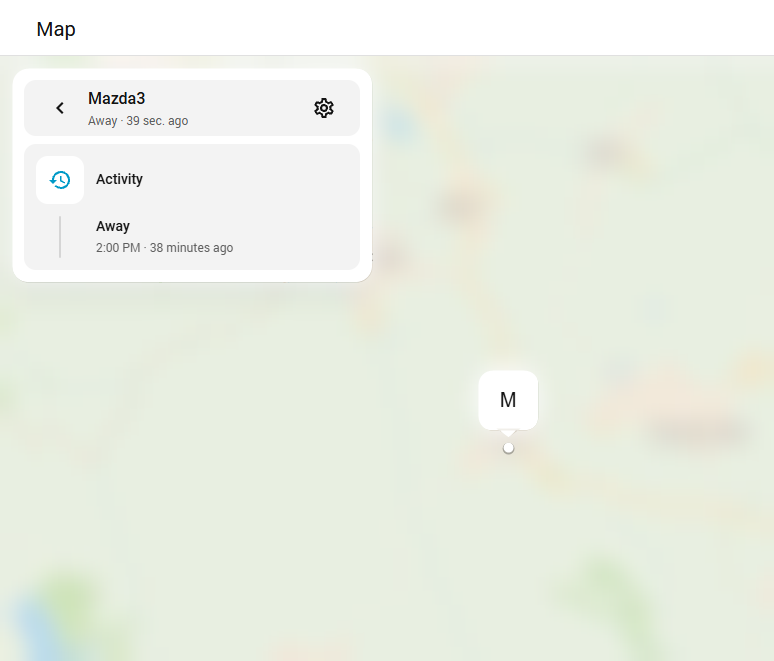
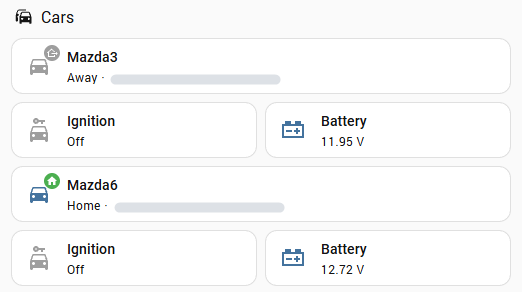
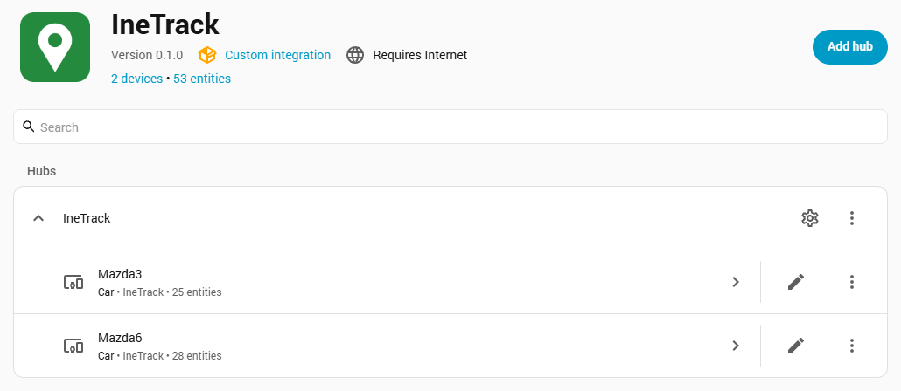

# IneTrack for Home Assistant

[](https://hacs.xyz/docs/faq/custom_repositories)
[](https://github.com/princzkeljanos/ha-inetrack/actions/workflows/validate.yml)

Unofficial Home Assistant integration for [IneTrack](https://inetrack.hu/) GPS trackers.
It puts your vehicles on the Home Assistant map and shows their speed, car battery
voltage, odometer, ignition and more.

> Not affiliated with Inepex Zrt. / IneTrack. It uses the public
> [IneTrack developer API](https://api.inetrack.com).

## What you get

One device per tracker. This is a car's device page (the street address is hidden):


The entities:

| Entity | Description |
| --- | --- |
| `device_tracker.<car>` | Position on the map. Zones such as *home* work automatically. Attributes: speed, heading, altitude, place, last report |
| `sensor.<car>_place` | The IneTrack POI the car is at (e.g. *Home*), otherwise the street address |
| `sensor.<car>_speed`, `sensor.<car>_heading` | From the last position report |
| `sensor.<car>_last_report` | When the tracker last reported a position |
| `sensor.<car>_car_battery_voltage` | Vehicle battery / supply voltage (V) |
| `sensor.<car>_odometer`, `sensor.<car>_trip_distance` | Tracker odometer and trip distance (km) |
| `binary_sensor.<car>_ignition` | Ignition on/off (from the tracker's ACC events) |
| `binary_sensor.<car>_moving` | On while a recent report shows more than 3 km/h |
| Diagnostic | Tracker battery voltage, satellites, GSM signal, server connection |
| Disabled by default | Altitude, GPS accuracy, street address, and every other raw value the tracker sends (digital inputs, sleep mode, …) |

Which sensors appear depends on what your tracker model sends; they are created when a
value is first seen. Values that identify the SIM card are never read into Home Assistant.

Each car also appears on the Home Assistant map (the map is blurred in this screenshot):



On a dashboard, standard tile cards are enough to show where each car is, its ignition and its
battery voltage (the addresses are hidden in this screenshot):



## Installation

### Marketplace (Home Assistant 2026.11+) or HACS

1. Open **Settings > Marketplace** (on older versions: **HACS**), then the **⋮** menu >
   **Custom repositories**.
2. Repository `https://github.com/princzkeljanos/ha-inetrack`, type **Integration**, **Add**.
3. Open **IneTrack** in the list, click **Download**, then restart Home Assistant.

### Manual

Copy `custom_components/inetrack` into the `custom_components` folder of your Home Assistant
configuration and restart.

## Configuration

You need an **API key** and the **IDs of your trackers** (the IneTrack API does not list
trackers, so you enter them once):

1. In IneTrack (<https://app.inetrack.com>) open **Settings > Security** and click
   **Generate new API key**. Generating a new key disables the previous one.
2. Click each car in IneTrack and copy the address from the browser. It looks like
   `https://app.inetrack.com/#home/devices?...route?trackerId=100001&realtime=y`;
   the number after `trackerId=` is the tracker ID.
3. In Home Assistant: **Settings > Devices & services > Add integration > IneTrack**.
   Paste the API key and the links (or just the IDs), one per line.
4. Give each tracker a name. This becomes the device name, e.g. `Mazda6` →
   `device_tracker.mazda6`.

Each tracker becomes a device under the IneTrack hub:



### Options

**Settings > Devices & services > IneTrack > Configure**:

| Option | Default | Description |
| --- | --- | --- |
| Trackers | | Add or remove trackers (removing one removes its device) |
| Update interval | 60 s | How often IneTrack is polled (30 - 3600 s) |
| Address lookup | on | Resolve the street address of the position |
| Tracker data | on | Read voltage, odometer and the other values the tracker sends |

If the API key is regenerated or disabled, Home Assistant shows a re-authentication
notice where you paste the new key.

## Example automations

```yaml
automation:
  - alias: "Car moved at night"
    triggers:
      - trigger: state
        entity_id: device_tracker.mazda6
        from: home
    conditions:
      - condition: time
        after: "23:00:00"
        before: "05:00:00"
    actions:
      - action: notify.notify
        data:
          message: "Mazda6 left home: {{ states('sensor.mazda6_place') }}"

  - alias: "Car battery low"
    triggers:
      - trigger: numeric_state
        entity_id: sensor.mazda6_car_battery_voltage
        below: 11.8
        for: "00:30:00"
    conditions:
      - condition: state
        entity_id: binary_sensor.mazda6_ignition
        state: "off"
    actions:
      - action: notify.notify
        data:
          message: "Mazda6 battery is at {{ states('sensor.mazda6_car_battery_voltage') }} V"
```

## Troubleshooting

- **"IneTrack refused the request"** during setup: the key is wrong or disabled, or a
  tracker ID belongs to another account.
- **Download diagnostics** (device page > ⋮) gives the raw API data with the key,
  coordinates and addresses removed. Attach it to issues.
- Debug logging:

  ```yaml
  logger:
    logs:
      custom_components.inetrack: debug
  ```

## Contributing

Pull requests are welcome. See [CONTRIBUTING.md](CONTRIBUTING.md) for the dev setup,
[docs/GETTING_STARTED.md](docs/GETTING_STARTED.md) for the publishing workflow, and
[docs/BRANCHING.md](docs/BRANCHING.md) for the branch policy. Report security problems
privately per [SECURITY.md](SECURITY.md).

- `custom_components/inetrack/api.py` is a standalone async client for the IneTrack API
  (no Home Assistant imports). API schema: <https://api.inetrack.com/apischema>.
- `python scripts/probe_api.py <tracker IDs>` shows what the API returns for your account
  (redacted, written to the git-ignored `probe-output.json`).
- Tests: `pip install -r requirements_test.txt`, then `pytest` (Python 3.14).

### IneTrack API notes

[docs/INETRACK_API.md](docs/INETRACK_API.md) documents how the IneTrack API behaves and the
known issues the integration works around.

## Support

This is a free, unofficial project maintained in my spare time. If it saved you some
and you'd like to say thanks, you can send a tip via Revolut — entirely optional, and
never required to use the integration.

<a href="https://revolut.me/princzkel">
  
</a>

**[revolut.me/princzkel](https://revolut.me/princzkel)**

Scan the QR code, or follow the link, to send a tip on Revolut — you can pay even if you
are not on Revolut yourself. Thank you! 🙏

<br clear="left">

## License

MIT
