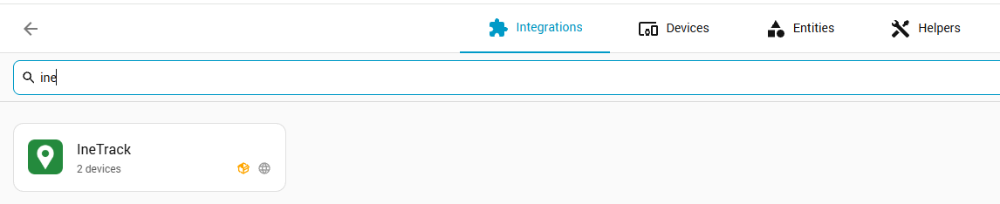

# Getting started: publishing and maintaining ha-inetrack

This is the maintainer's guide: how the repository is laid out, how to put it on GitHub,
install it in Home Assistant through the Marketplace, and ship updates.

## 1. What is in the repository

```
custom_components/inetrack/   the integration (this folder is what Home Assistant loads)
  api.py                      IneTrack API client, no Home Assistant code
  coordinator.py              polls the API, keeps the newest value of everything
  config_flow.py              setup dialog, re-authentication, options
  device_tracker.py           map position
  sensor.py / binary_sensor.py
  diagnostics.py              redacted debug download
  translations/en.json, hu.json
  brand/icon.png              icon shown in Home Assistant and the Marketplace
  manifest.json               domain, version, links (version must be bumped per release)
hacs.json                     tells the Marketplace (HACS) this is an integration
tests/                        pytest tests (run on GitHub Actions)
scripts/probe_api.py          developer tool: dumps what the API returns for your account
.github/workflows/validate.yml  hassfest + Marketplace validation + lint + tests
```

### What the IneTrack API can and cannot do (tested November 2026)

| Works with an API key | Fails (HTTP 500) |
| --- | --- |
| `GetLastReports` (position, POI, address) | `ListUserDevices` / any tracker list |
| `GetExtendedDataList` (voltage, odometer, I/O) | `GetConnectionStates` |
| `GetLastOneStatusData` (GSM signal) | `ListStatusDataRules`, `GetStatusDataList` |
| `GetLastOneDeviceEvents` (ACC on/off, connected) | |

That is why the setup dialog asks for tracker IDs. If IneTrack fixes `ListUserDevices`,
the setup dialog already uses it when the tracker field is left empty.

## 2. Create the GitHub repository

1. On GitHub click **New repository**.
2. Name: `ha-inetrack`. Description: *Home Assistant integration for IneTrack GPS trackers*.
3. **Public** (the Marketplace only installs from public repositories).
4. Do **not** add a README, .gitignore or license (they are already here).
5. Click **Create repository**.
6. On the repository page, click the gear next to **About** and add the topics
   `home-assistant`, `hacs`, `homeassistant-integration`, `inetrack`, `gps-tracker`.

The repository URL (`github.com/princzkeljanos/ha-inetrack`) is referenced in
`custom_components/inetrack/manifest.json` and `README.md`; update both if you rename it.

## 3. Push the code

In a terminal in this folder:

```bash
git init -b main
git add .
git commit -m "Initial IneTrack integration"
git remote add origin https://github.com/princzkeljanos/ha-inetrack.git
git push -u origin main
```

The first push opens a browser window to sign in to GitHub (Git Credential Manager).

Check that `probe-output.json` and `.inetrack_key` were **not** committed
(`git status` should not list them; they are in `.gitignore`).

Then open the **Actions** tab on GitHub: the *Validate* workflow should turn green.

## 4. Create a release

The Marketplace shows releases as versions (without releases it installs the latest commit).

1. On GitHub: **Releases > Draft a new release**.
2. Tag: `v0.1.0` (must match `"version"` in `manifest.json`), title `v0.1.0`.
3. **Generate release notes**, then **Publish release**.

## 5. Install it in Home Assistant

1. **Settings > Marketplace > ⋮ > Custom repositories**: add
   `https://github.com/princzkeljanos/ha-inetrack`, type **Integration**.
   (The Marketplace may ask you to connect a GitHub account first; it uses GitHub's
   device login, so you approve a code on github.com and never type your password into
   Home Assistant.)
2. Open **IneTrack**, click **Download**, restart Home Assistant.
3. **Settings > Devices & services > Add integration > IneTrack**: paste the API key and
   your tracker links, then name the trackers.

IneTrack then shows under **Settings > Devices & services**, marked as a custom integration
(the box icon) that needs the internet (the globe):



## 6. Ship an update

1. Change the code, bump `"version"` in `manifest.json` (e.g. `0.1.1`).
2. Commit and push; wait for the *Validate* workflow to pass.
3. Create a release with the matching tag (`v0.1.1`).
4. Home Assistant shows an update for IneTrack under **Settings > Updates**.

## 7. Optional: get listed in the Marketplace catalog

Custom repositories work for anyone who has the link. To appear in the Marketplace search
for everyone, the repository must pass the HACS check in `.github/workflows/validate.yml`
(it runs every check: description, topics, brand icon, ...) and have at least one release;
then open a pull request to
[hacs/default](https://github.com/hacs/default) adding `princzkeljanos/ha-inetrack` to
the `integration` list.

## 8. Development loop

```bash
python -m venv .venv
.venv/Scripts/activate            # Windows (on Linux/macOS: source .venv/bin/activate)
pip install -r requirements_test.txt aiohttp
python scripts/probe_api.py 100001 100002   # see what the API returns (redacted)
ruff check . && ruff format .
pytest                            # use Python 3.14 (older versions get an old HA)
```

`scripts/probe_api.py` can save the API key to `.inetrack_key` (git-ignored) so it does not
ask every time. Delete that file, or generate a new key in IneTrack, when you are done.
